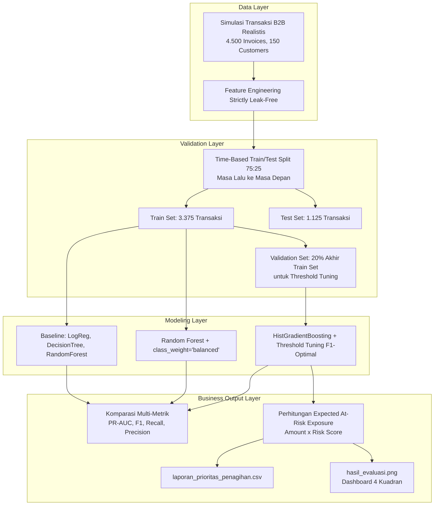

# Prediksi-Risiko-Finansial-Pencegahan-Data-Leakage-Penanganan-Imbalanced-Data

# 📊 Enterprise Invoice Late Payment Prediction System
### *Make Sense of Data with Analysis and AI — Studi Kasus: PT Maju Bersama*

[](https://www.python.org/)
[](https://scikit-learn.org/)
[]()

Sistem *Machine Learning* tingkat lanjut (*enterprise-grade*) untuk memprediksi probabilitas keterlambatan pembayaran invoice (**keterlambatan > 30 hari pasca jatuh tempo**) secara dini sebelum invoice jatuh tempo. 

Dirancang dengan prinsip **strictly leak-free**, validasi berbasis urutan waktu (*temporal time-based validation*), mitigasi ketimpangan kelas (*class imbalance*), serta integrasi metrik finansial **Expected At-Risk Exposure** untuk memandu tindakan proaktif tim *Accounts Receivable* (AR) dan *Collection*.

---

## 📑 Daftar Isi
1. [Latar Belakang & Masalah Bisnis](#-latar-belakang--masalah-bisnis)
2. [Arsitektur & Alur Pipeline](#-arsitektur--alur-pipeline)
3. [Rekayasa Fitur & Pencegahan Data Leakage](#-rekayasa-fitur--pencegahan-data-leakage)
4. [Eksperimen & Hasil Evaluasi Model](#-eksperimen--hasil-evaluasi-model)
5. [Inovasi Finansial: Expected At-Risk Exposure & Risk Tiering](#-inovasi-finansial-expected-at-risk-exposure--risk-tiering)
6. [Dashboard Visualisasi Analitik (4 Kuadran)](#-dashboard-visualisasi-analitik-4-kuadran)
7. [Panduan Instalasi & Eksekusi](#-panduan-instalasi--eksekusi)
8. [Struktur Berkas Proyek](#-struktur-berkas-proyek)

---

## 🏢 Latar Belakang & Masalah Bisnis

Di sektor perdagangan B2B (*Business-to-Business*), keterlambatan pembayaran tagihan adalah salah satu ancaman terbesar bagi kesehatan arus kas (*cash flow*) perusahaan. PT Maju Bersama melayani beragam segmen (*retail, grosir, horeca*) dengan termin pembayaran 14 hingga 60 hari.

**Masalah Operasional:**
* Tim penagihan biasanya hanya bersifat **reaktif** (menghubungi pelanggan setelah invoice menunggak).
* Kapasitas tim koleksi terbatas sehingga tidak semua pelanggan dapat ditelepon satu per satu.
* Penagihan berbasis nominal saja mengabaikan profil risiko pelanggan, sementara penagihan berbasis persentase risiko saja mengabaikan besaran nominal yang berisiko hilang.

**Solusi Sistem:**
Membangun mesin prediksi cerdas yang menghasilkan **probabilitas risiko keterlambatan (`risk_score`)** dan **nilai rupiah yang terpapar risiko (`expected_risk_exposure`)**, lalu mengelompokkannya ke dalam *Standard Operating Procedure* (SOP) aksi penagihan terukur.

---

## 🏗️ Arsitektur & Alur Pipeline



---

## 🔬 Rekayasa Fitur & Pencegahan Data Leakage

Pencegahan kebocoran data (*data leakage*) adalah prioritas mutlak dalam pemodelan data finansial:

### 1. Fitur yang Wajib Dibuang (*Dropped / Forbidden Features*)
* `payment_date` & `days_overdue`: Fitur ini baru diketahui **setelah** invoice dibayar oleh pelanggan di masa depan. Jika disertakan dalam training, akurasi akan terlihat 100% secara palsu (*leakage*), namun gagal total saat produksi.
* `latent_risk`: Nilai risiko laten sintetis yang tidak bisa diobservasi langsung di dunia nyata.
* `invoice_date`, `due_date`, `customer_id`: Dihapus dari matriks fitur untuk mencegah model mengalami *overfitting* pada tanggal atau identitas tertentu.

### 2. Fitur Historis Bebas Bocor (*Leak-Free Historical Features*)
Semua fitur berbasis pelanggan dihitung hanya menggunakan transaksi **sebelumnya** menggunakan kombinasi `.shift(1)` dan `.expanding()`:
* **`prev_late_rate`**: Rata-rata tingkat keterlambatan masa lalu pelanggan sebelum invoice saat ini diterbitkan.
* **`prev_invoice_count`**: Frekuensi transaksi pelanggan terdahulu (mengukur loyalitas dan rekam jejak).
* **`amount_to_avg_ratio`**: Rasio nominal invoice terhadap rata-rata belanja historis pelanggan. Lonjakan tagihan yang tidak wajar (misal $3\times$ lipat dari biasanya) seringkali berkorelasi dengan gagal bayar.
* **`log_amount`**: Transformasi logaritmik $\ln(1 + \text{amount})$ untuk meredam skewness distribusi log-normal pada nominal transaksi.
* **`is_high_discount`**: Indikator apakah invoice memiliki diskon $\ge 5\%$ (apakah insentif diskon percepatan bayar efektif).
* **`is_ramadan_season`**: Indikator efek musiman (Bulan Maret-April / Ramadhan & Lebaran) saat kebutuhan likuiditas meningkat pesat.
* **`is_long_term`**: Indikator termin panjang ($\ge 45$ hari).

---

## 📊 Eksperimen & Hasil Evaluasi Model

Evaluasi diuji secara ketat pada data uji masa depan (*Test Set* = 1.125 invoice, *late rate* aktual ~19.6%):

| Model | Accuracy | Recall | Precision | F1-Score | PR-AUC | Catatan & Analisis Bisnis |
| :--- | :---: | :---: | :---: | :---: | :---: | :--- |
| **Logistic Regression (Baseline)** | 0.821 | 0.000 | 0.000 | 0.000 | 0.171 | **Paradoks Akurasi**: Akurasi 82.1% tampak baik, namun model memprediksi 0 untuk seluruh invoice. Recall 0% = Gagal total mendeteksi invoice macet! |
| **Decision Tree (Baseline)** | 0.852 | 0.269 | 0.730 | 0.393 | 0.457 | Presisi cukup bagus (73%), namun hanya mampu menangkap 26.9% invoice yang telat. |
| **Random Forest (Baseline)** | 0.847 | 0.209 | **0.764** | 0.328 | 0.522 | Sangat berhati-hati dalam memprediksi (presisi tinggi), tetapi melewatkan ~79% invoice bermasalah. |
| **Random Forest + `class_weight`** | **0.856** | 0.423 | 0.649 | **0.512** | **0.522** | **Performa Terbaik secara F1-Score (0.512)**. Keseimbangan solid antara presisi (64.9%) dan daya tangkap keterlambatan (42.3%). |
| **HistGradientBoosting + Tuned (0.40)** | 0.793 | **0.433** | 0.422 | 0.428 | 0.483 | **Recall Tertinggi (43.3%)**. Menggunakan GBDT modern dengan threshold hasil tuning validasi temporal (0.40). Sangat agresif menangkap invoice macet. |

> 📌 **Mengapa Bukan Akurasi?**  
> Pada kasus *class imbalance*, memprediksi "semua aman" menghasilkan akurasi tinggi (>80%) tetapi tidak ada nilainya bagi bisnis. Oleh karena itu, optimasi difokuskan pada **Recall** (menekan *bad debt* yang lolos), **Precision** (menghemat waktu tim penagihan dari *false alarm*), dan **PR-AUC**.

---

## 💰 Inovasi Finansial: Expected At-Risk Exposure & Risk Tiering

Dalam praktiknya, mengurutkan tagihan hanya berdasarkan persentase risiko (`risk_score`) dapat menyesatkan:
* *Contoh:* Invoice Rp 300.000 dengan risiko 90% hanya berpotensi kerugian **Rp 270.000**.
* *Bandingkan:* Invoice Rp 120.000.000 dengan risiko 75% berpotensi kerugian **Rp 90.000.000**!

Sistem mengadopsi standar manajemen risiko kredit perbankan dengan formula:
$$\text{Expected At-Risk Exposure} = \text{Invoice Amount} \times \text{Risk Score}$$

### Matriks Segmentasi & Tindakan Koleksi (SLA Penagihan):

| Kategori Risiko | Batas Skor Risiko | Tindakan & Rekomendasi Operasional |
| :--- | :---: | :--- |
| 🔴 **1. TINGGI (High Risk)** | $\text{Skor} \ge 0.70$ | **Tindakan Intensif**: Telepon H-7, konfirmasi faktur pajak, tawarkan *split payment* atau diskon percepatan, tahan order baru sebelum tagihan lunas. |
| 🟡 **2. SEDANG (Medium Risk)** | $0.45 \le \text{Skor} < 0.70$ | **Tindakan Preventif**: Kirim reminder otomatis via WhatsApp / Email pada H-3, serta konfirmasi jadwal kliring cek/giro. |
| 🟢 **3. RENDAH (Low Risk)** | $\text{Skor} < 0.45$ | **Jalur Standar**: Kirimkan invoice normal dan proses penagihan reguler tanpa intervensi manual. |

Hasil analisis diekspor langsung ke file `laporan_prioritas_penagihan.csv` yang siap dibuka di Microsoft Excel oleh staf keuangan.

---

## 📈 Dashboard Visualisasi Analitik (4 Kuadran)

File `hasil_evaluasi.png` dibuat secara otomatis dengan 4 visualisasi komprehensif:
1. **Kuadran Kiri Atas (Feature Importance):** Menampilkan variabel yang paling menentukan keterlambatan (misal: rasio nominal `amount_to_avg_ratio`, rekam jejak `prev_late_rate`, dan termin pembayaran).
2. **Kuadran Kanan Atas (Precision-Recall Curve):** Menggambarkan trade-off presisi vs recall model terhadap garis acuan acak (*baseline*).
3. **Kuadran Kiri Bawah (Total Tagihan Terpapar Risiko per Tier):** Rekapitulasi total miliaran rupiah pada kategori High, Medium, dan Low Risk.
4. **Kuadran Kanan Bawah (Confusion Matrix):** Rincian jumlah True Positive, False Positive, True Negative, dan False Negative pada data uji.

---

## ⚙️ Panduan Instalasi & Eksekusi

### 1. Kebutuhan Sistem
* Python 3.8 ke atas
* Terminal / Command Prompt

### 2. Instalasi Paket Dependensi
```bash
pip install pandas numpy scikit-learn matplotlib
```

### 3. Menjalankan Pipeline
Jalankan file script utama melalui terminal:
```bash
python "prediksi_invoice_telat (1).py"
```

Output terminal akan mencetak perbandingan metrik seluruh model, daftar 10 invoice berisiko tertinggi, serta otomatis memperbarui file `laporan_prioritas_penagihan.csv` dan `hasil_evaluasi.png`.

---

## 📂 Struktur Berkas Proyek

```text
Make Sense of Data With analysis and AI/
│
├── README.md                          # Dokumentasi lengkap sistem & panduan analisis
├── prediksi_invoice_telat (1).py      # Kode modular berorientasi objek (InvoiceRiskEngine)
├── laporan_prioritas_penagihan.csv    # Output prioritas tagihan siap pakai untuk tim Finance/AR
└── hasil_evaluasi.png                 # Dashboard grafis analitik 4 kuadran
```

---

## 💡 Nilai Tambah bagi Pengambil Keputusan (CFO / Finance Manager)
* **Pencegahan Bad Debt**: Mencegah kerugian arus kas hingga puluhan/ratusan juta rupiah per bulan dengan peringatan dini sebelum jatuh tempo.
* **Efisiensi Tenaga Kerja**: Tim penagihan fokus pada 20% pelanggan berisiko tinggi yang menyumbang 80% potensi gagal bayar (*Pareto Principle*).
* **Bebas Bias & Akuntabel**: Rekomendasi didasarkan pada data historis objektif dan model *machine learning* yang transparan serta bebas dari *data leakage*.
